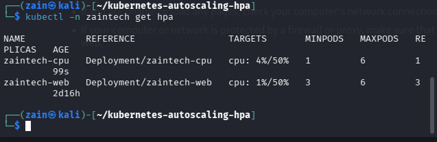
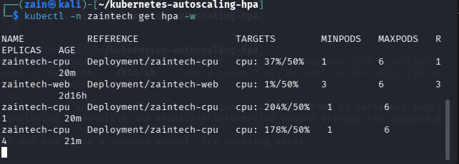
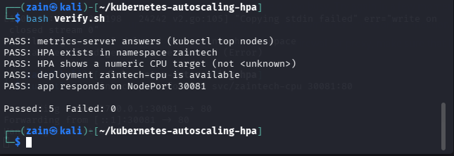

# Kubernetes Autoscaling under Load — HPA in Action

A hands-on autoscaling setup on a local 3-node [kind](https://kind.sigs.k8s.io/) cluster:
a small CPU-burning web app starts at **1 replica**, and when real HTTP load is
generated against it, the **Horizontal Pod Autoscaler (HPA)** scales it up on its
own — and back down when the load stops. No cloud account, no cost.

Built and run on a Kali Linux home lab (kind cluster `zaintech`: 1 control-plane
+ 2 workers).

## How it works

```
                ┌───────────────┐   CPU %    ┌─────────────┐
  load ───────► │  Service      │ ◄───────── │    HPA      │
 (busybox pod)  │  (NodePort    │            │  target 50% │
                │   :30081)     │            └──────┬──────┘
                └──────┬────────┘                 │ scale
                       │                          ▼
                ┌──────▼────────┐         ┌─────────────┐
                │  CPU app pods │ ◄────── │ Deployment  │
                │  (1 → 6)      │  metrics│ replicas    │
                └───────────────┘         └─────────────┘
                       ▲
                       │ metrics-server (kubectl top / HPA feed)
                ┌──────┴────────┐
                │  kubelets     │
                └───────────────┘
```

- **metrics-server** collects pod CPU from the kubelets (patched with
  `--kubelet-insecure-tls`, which kind requires).
- **HPA (autoscaling/v2)** compares actual CPU against the pods' CPU *requests*
  (200m) with a 50% utilization target, min 1 / max 6 replicas.
- The app (`app/server.py`) burns a little CPU per request, so HTTP load turns
  into measurable CPU — the same reason real apps must set resource requests:
  **without requests, HPA has nothing to measure against.**

## Run it

```bash
bash scripts/setup.sh
```

Then watch the autoscaling happen, in two terminals:

```bash
# terminal 1 — watch the HPA react
kubectl -n zaintech get hpa --watch

# terminal 2 — generate load (Ctrl+C to stop)
bash scripts/generate-load.sh
```

Within a minute or two the TARGETS column climbs past 50%, replicas scale
1 → 6, and after the load stops they scale back down to 1.

App in the browser (kind only maps the ports declared at cluster creation,
so use a port-forward):

```bash
kubectl -n zaintech port-forward svc/zaintech-cpu 30081:80
# then open http://localhost:30081
```

Verify the moving parts:

```bash
bash verify.sh
```

## Layout

```
app/          CPU-burning demo app (Python) + Dockerfile
manifests/    deployment.yaml · service.yaml · hpa.yaml
scripts/      setup.sh · generate-load.sh
verify.sh     component checks (metrics API, HPA target, app response)
docs/         run screenshots
```

## Verified run — 9 November 2026

Run end to end on the local kind cluster `zaintech`:

- metrics-server installed with the kind TLS patch — `kubectl top nodes` answers
- The pre-existing `zaintech-web` HPA, stuck at `cpu: <unknown>/50%` for two
  days, came alive and reported a real 1%
- **Before load:** `zaintech-cpu` at **cpu 4%/50%**, **1 replica**

  
- **Under load** (busybox pod generating requests against the service
  ClusterIP): CPU climbed to **204%** and the HPA scaled the deployment
  **1 → 4 replicas** on its own

  
- **verify.sh — Passed: 5, Failed: 0**

  

One lab note: pods in this cluster could not resolve service DNS names from
the busybox image (`wget: bad address` for both the short name and the FQDN),
so the load generator targets the service ClusterIP, which the script looks
up through the Kubernetes API.

## About Cluster Autoscaler

HPA adds **pods**; the **Cluster Autoscaler** adds **nodes** when pods no longer
fit. On a local kind cluster the node count is fixed by the machine, so cluster
autoscaling is out of scope here by design — on managed Kubernetes (EKS/GKE/AKS)
it watches for unschedulable pods and grows the node group, then shrinks it when
nodes sit empty. The HPA half of this repo is the part that behaves identically
in both worlds.

## Author

Zain Ul Abdin — Zain Tech Automation Solutions
